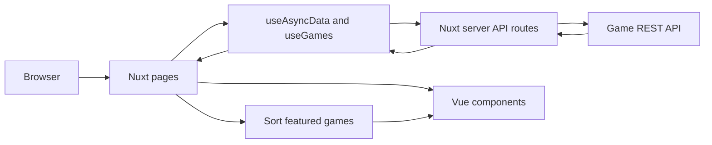

# Client Application

This folder is reserved for your frontend application.

## Getting Started

Build your frontend application (Next.js, Nuxt, React, Vue, etc.) in this directory to connect to the Game API.

### Example Structure

```
client/
├── package.json
├── src/
│   ├── components/
│   ├── pages/
│   └── ...
└── ...
```

### Connecting to the API

The backend API runs on `http://localhost:8000` by default. Available endpoints:

- **REST API**: `http://localhost:8000/api/v1`
- **GraphQL**: `http://localhost:8000/graphql`
- **API Docs**: `http://localhost:8000/api-docs`

See the main [README.md](../README.md) for full API documentation.

## Client commands

Run these commands from the `client/` directory:

| Command            | Purpose                      |
| ------------------ | ---------------------------- |
| `npm install`      | Install client dependencies  |
| `npm run dev`      | Start the development server |
| `npm run build`    | Create a production build    |
| `npm run preview`  | Preview a production build   |
| `npm run generate` | Generate a static site       |
| `npm run test`     | Run the client unit tests    |
| `npm run test:e2e` | Run the client e2e tests     |

## How API data flows through the client

The browser-facing API routes live in `src/server/api/`. They call the backend API using the `gameApiUrl` Nuxt runtime configuration value.

- `GET /api/games` requests a page of games. It forwards pagination parameters and, when selected, the genre ID. It also requests game statistics and converts backend game records into the shape used by the Vue components.
- `GET /api/genres` loads the list of genre IDs and names for the filter.
- `GET /api/games/:id` loads and maps the details for one game.

The games route applies the genre and search filters, selects up to 15 games released from 2015 through 2017, and adds rating statistics. The genres route provides filter options, while the detail route returns one mapped game with its reviews. Nuxt fetches initial page data during SSR and reuses it during hydration.

## Project structure

```text


client/
├── src/
│   ├── assets/
│   │   └── scss/
│   ├── app.vue               # Main application entry point
│   ├── components/
│   │   ├── common/           # Reusable components such as Header, Error, and Loading
│   │   └── game/             # Game-related components such as cards, grids, genres, ratings, and reviews
│   ├── composables/
│   │   └── useGames.ts       # Handles API calls, game data processing, and related logic
│   ├── pages/
│   │   ├── index.vue         # Game listing page with browsing, sorting, filtering, and pagination
│   │   └── games/
│   │       └── [id].vue      # Game details page
│   ├── server/
│   │   ├── api/              # Nuxt server-side API proxy routes for communicating with the external API
│   │   └── utils/            # Maps API responses to the application's game data structure
│   ├── types/
│   │   └── game.ts           # Defines TypeScript types for games, reviews, and genres to ensure type safety
│   └── utils/                # Utility functions for date formatting, sorting, and other shared operations
├── tests/                    # Unit tests for utilities, composables, and API routes
├── nuxt.config.ts            # Nuxt application configuration
├── package.json              # Project metadata, dependencies, and npm scripts
└── vitest.config.ts          # Vitest configuration for unit testing

```

## Tests

Vitest covers utility behavior, composables, API mapping, and server routes. Playwright covers SSR output, browsing flows, responsive layout, and key error states.

Run the checks from `client/`:

```bash
npm run test
npm run test:e2e
npm run typecheck
```

## Implementation notes

- The genre selector sends the selected genre's numeric ID; the visible name is its label.
- The client consumes REST through Nuxt server routes and does not use GraphQL.
- Initial page data is fetched during SSR and reused for hydration.
- A fresh server request builds a new random featured selection. During client-side navigation, successful results are reused for ten minutes by query key.
- Genre and detail API routes use Nitro's ten-minute cache.
- Date-only release values are formatted in UTC to prevent the calendar day from shifting with the viewer's time zone.

# Reference Links

# Nuxt.js and Vue.js Project Setup

Nuxt.js Documentation: https://nuxt.com/docs/4.x/getting-started/introduction

# Design References

The following resources were used as references for styling, color selection, and animations:

Colors: https://tailwindcss.com/docs/colors

Themes and CSS Styling: https://developer.mozilla.org/en-US/docs/Web/CSS

Animations: https://animista.net/

Note: The README.md file was formatted using Google, which may have affected its formatting and appearance.

## Client architecture



# Repository

`https://github.com/rohit1121996/merkle-games-app
`
